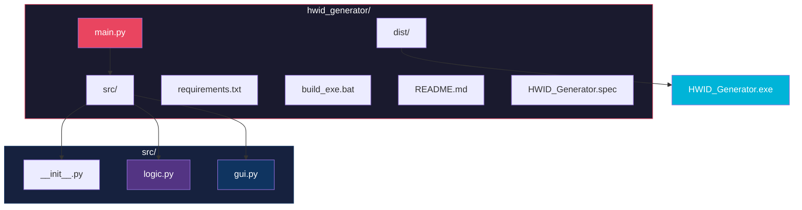
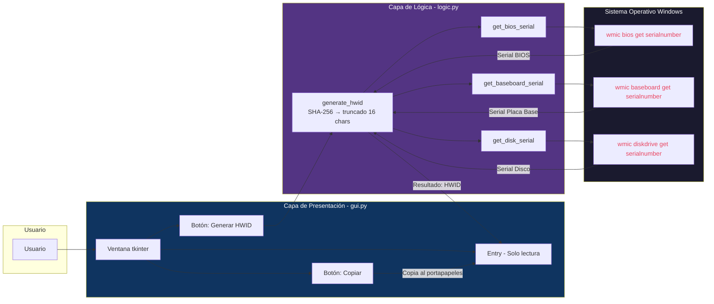
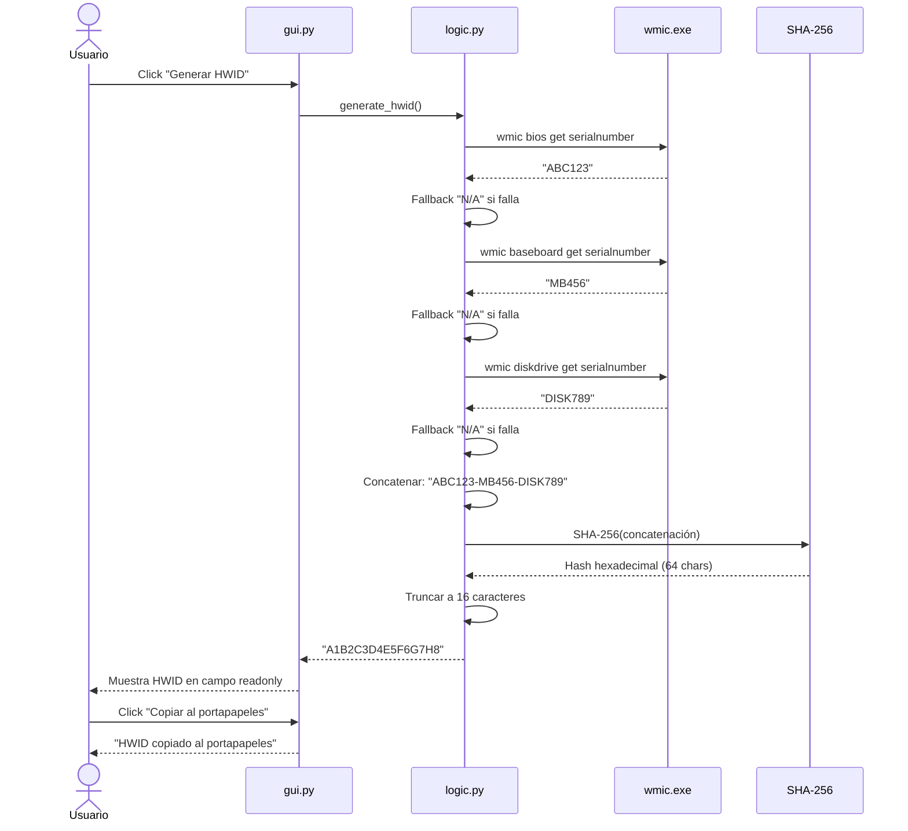
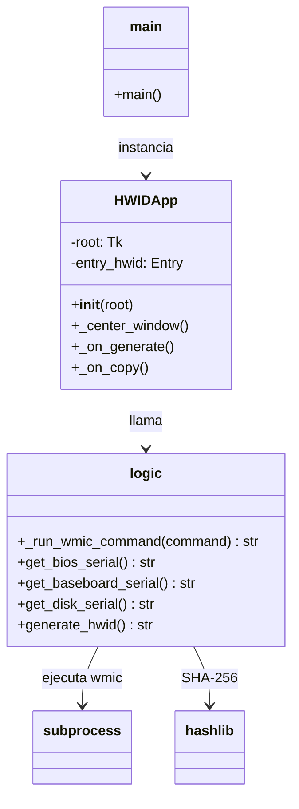
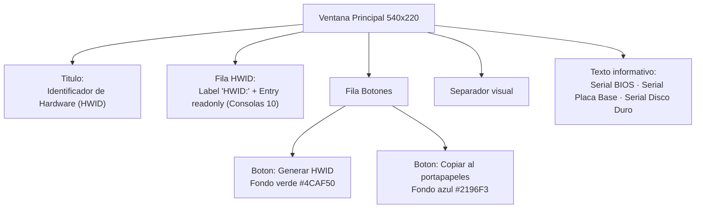
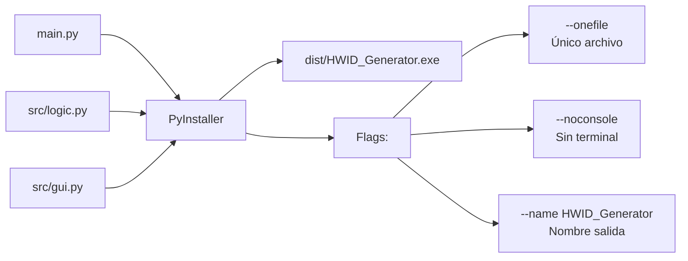
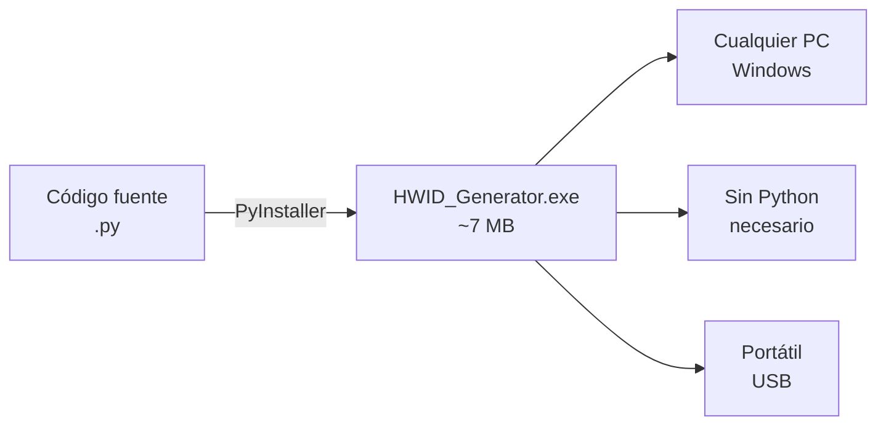
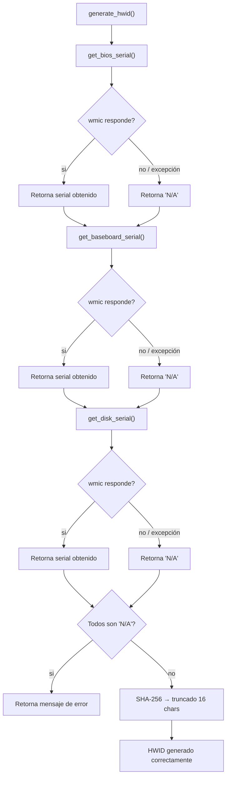
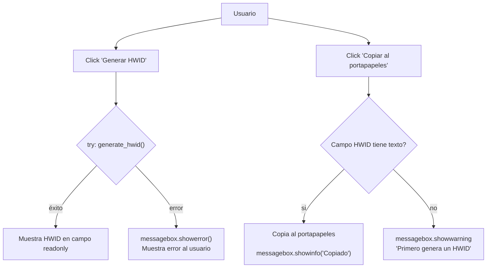

# Generador de HWID


Aplicación de escritorio para generar un **Identificador de Hardware (HWID)** único a partir de componentes del sistema. El HWID se obtiene combinando seriales de hardware y aplicando un hash **SHA-256** truncado a 16 caracteres.

---

## 📋 Índice

- [Estructura del Proyecto](#-estructura-del-proyecto)
- [Arquitectura](#-arquitectura)
- [Flujo de Generación del HWID](#-flujo-de-generación-del-hwid)
- [Diagrama de Clases](#-diagrama-de-clases)
- [Interfaz Gráfica](#-interfaz-gráfica)
- [Requisitos](#-requisitos)
- [Ejecución](#-ejecución)
- [Compilación a .exe](#-compilación-a-exe)
- [Prueba del Módulo Lógico](#-prueba-del-módulo-lógico)
- [Manejo de Errores](#-manejo-de-errores)

---

## 📁 Estructura del Proyecto



### Descripción de archivos

| Archivo | Propósito |
|---------|-----------|
| `main.py` | Punto de entrada de la aplicación. Inicializa la ventana tkinter. |
| `src/logic.py` | Módulo de lógica: obtiene seriales de hardware y genera el hash SHA-256. |
| `src/gui.py` | Módulo de interfaz: construye la ventana, botones y manejo de eventos. |
| `requirements.txt` | Lista de dependencias necesarias (`pywin32`, `wmi`, `pyinstaller`). |
| `build_exe.bat` | Script para compilar el proyecto a un ejecutable `.exe`. |
| `dist/HWID_Generator.exe` | Ejecutable compilado listo para usar. |

---

## 🏗️ Arquitectura



La aplicación sigue una **arquitectura de 3 capas**:

1. **Capa de Presentación** (`gui.py`): Interfaz gráfica construida con tkinter.
2. **Capa de Lógica** (`logic.py`): Contiene toda la lógica de negocio (obtención de datos + hashing).
3. **Capa de Sistema** (Windows API): Consultas `wmic` al sistema operativo.

---

## 🔄 Flujo de Generación del HWID



### Paso a paso

1. El usuario hace clic en **"Generar HWID"**.
2. `logic.py` ejecuta 3 consultas `wmic` para obtener seriales de BIOS, placa base y disco duro.
3. Si alguna consulta falla, se usa `"N/A"` como valor de reemplazo (nunca se interrumpe el proceso).
4. Los 3 valores se concatenan con guiones: `SERIAL_BIOS-SERIAL_BASE-SERIAL_DISCO`.
5. Se calcula el hash **SHA-256** de esa cadena.
6. El resultado se trunca a **16 caracteres hexadecimales**.
7. El HWID se muestra en el campo de texto de solo lectura.
8. El usuario puede copiarlo al portapapeles con el botón **"Copiar"**.

---

## 🧩 Diagrama de Clases



---

## 🖥️ Interfaz Gráfica

La ventana principal se construye con **tkinter** y tiene las siguientes secciones:



### Disposición visual

```
┌─────────────────────────────────────────────────────────┐
│         Identificador de Hardware (HWID)                │
│                                                         │
│    HWID: [_______________________________________]     │
│                                                         │
│     [Generar HWID]    [Copiar al portapapeles]          │
│    ─────────────────────────────────────────────         │
│    Basado en: Serial BIOS · Serial Placa Base · Serial  │
│    Disco Duro                                            │
└─────────────────────────────────────────────────────────┘
```

### Características de la interfaz

| Elemento | Descripción |
|----------|-------------|
| **Título** | "Identificador de Hardware (HWID)" en negrita, tamaño 14 |
| **Campo HWID** | Caja de texto con fuente `Consolas`, solo lectura, ancho 55 |
| **Botón Generar** | Fondo verde `#4CAF50`, texto blanco, llama a `generate_hwid()` |
| **Botón Copiar** | Fondo azul `#2196F3`, texto blanco, copia al portapapeles |
| **Texto inferior** | Indica las fuentes del HWID en gris, tamaño 8 |
| **Ventana** | 540x220 píxeles, no redimensionable, centrada en pantalla |

---

## 📦 Compilación a .exe



### Método 1: Script automatizado

Ejecuta `build_exe.bat` (doble clic o desde terminal):

```bash
cd hwid_generator
build_exe.bat
```

### Método 2: Manual con PyInstaller

```bash
cd hwid_generator
pip install -r requirements.txt
pyinstaller --onefile --noconsole --name HWID_Generator main.py
```

### Resultado



> **Nota:** El `.exe` incluye Python y todas las dependencias. Puedes llevarlo en un USB y ejecutarlo en cualquier PC con Windows.

---

## 🧪 Prueba del Módulo Lógico

```bash
cd hwid_generator
python -m src.logic
```

Salida esperada:
```
Generando HWID...
HWID Generado: A1B2C3D4E5F6G7H8
```

---

## 🛠️ Manejo de Errores

### Errores en la obtención de hardware (`logic.py`)



### Errores en la interfaz gráfica (`gui.py`)



### Casos contemplados y su comportamiento

| Escenario | ¿Dónde ocurre? | Comportamiento |
|-----------|---------------|---------------|
| `wmic` no está disponible en el sistema | `logic.py` | `try/except` captura `FileNotFoundError`, retorna `None` → se asigna `"N/A"` |
| Serial de BIOS vacío | `logic.py` | `get_bios_serial()` retorna `"N/A"` |
| Serial de placa base vacío | `logic.py` | `get_baseboard_serial()` retorna `"N/A"` |
| Serial de disco duro vacío | `logic.py` | `get_disk_serial()` retorna `"N/A"` |
| Los 3 seriales fallan (todos `"N/A"`) | `logic.py` | `generate_hwid()` retorna `"ERROR: No se pudieron obtener suficientes datos de hardware"` |
| Error inesperado al generar HWID | `gui.py` | `messagebox.showerror()` muestra el detalle de la excepción al usuario |
| Usuario hace clic en "Copiar" sin HWID generado | `gui.py` | `messagebox.showwarning()` informa que primero debe generar un HWID |

---

## 📄 Licencia

Este proyecto es de código abierto. Siéntete libre de modificarlo y distribuirlo.

---
